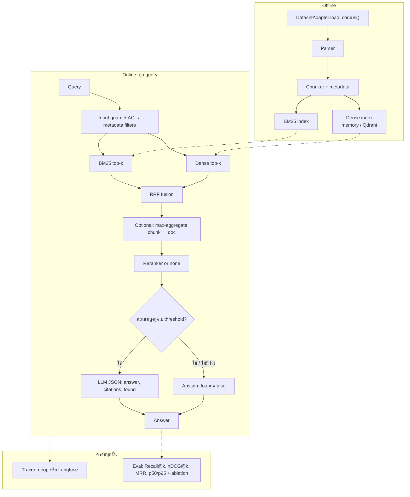

# ragkit

เฟรมเวิร์ก RAG แบบปลั๊กอิน ที่ไม่ผูกกับชุดข้อมูลใดชุดข้อมูลหนึ่ง เขียน pipeline เป็นฟังก์ชัน/คลาสธรรมดา (ไม่ใช้ LangChain chain) เลือกแต่ละขั้นผ่าน YAML แล้วค่อยไป optimize ภายในตาม dataset ทีหลัง

เหมาะกับการต่อ **LitSearch** (ค้นเปเปอร์), **FinanceBench** (PDF 10-K), และ **WangchanX-Legal-ThaiCCL-RAG / NitiBench** (มาตรากฎหมายไทย) โดยใช้โค้ดแกนเดียวกัน เปลี่ยนแค่ adapter, config และจุดที่ควรจูน

## สถาปัตยกรรม



จุดออกแบบที่ตั้งใจไว้:

- **กรองสิทธิ์ตอนค้น** ภายใน retriever ไม่ใช่ค้นทั้งหมดแล้วค่อยตัด — เอกสารที่ไม่มีสิทธิ์จะไม่ถูกส่งให้ LLM
- **เอกสารใน context คือข้อมูล ไม่ใช่คำสั่ง** (grounded prompt + ตรวจ citations ให้อยู่ใน id ที่ส่งไปเท่านั้น)
- **abstain** ได้เมื่อคะแนน rerank สูงสุดต่ำกว่าเกณฑ์ หรือไม่มี hit
- ทุกขั้นเปลี่ยนได้ผ่าน registry: `loader` / `parser` / `chunker` / `retriever` / `reranker` / `generator` / `tracer`

## แผนผังโฟลเดอร์

```
ragkit/
  configs/
    base.yaml              # ค่าเริ่มต้นของทั้ง pipeline
    litsearch.yaml         # override เท่านั้น (extends: base.yaml)
    financebench.yaml
    nitibench.yaml
  src/ragkit/
    models.py              # Document, Chunk, Query, ScoredHit, Answer, EvalExample
    pipeline.py            # RAGPipeline.from_config / search / answer
    cli.py                 # ingest, index, search, eval, ablate
    api.py                 # FastAPI: POST /search, /answer
    loaders/               # DatasetAdapter + stub 3 ชุด + folder adapter
    parsers/               # text, pdf (pymupdf), hook docling
    chunkers/              # structure-aware + fixed-size, Thai-safe split
    retrievers/            # BM25, dense, hybrid RRF, stores/, embedders
    rerankers/             # none, cross_encoder, qwen (P(yes))
    generators/            # fake, OpenAI-compatible (Ollama/vLLM)
    eval/                  # metrics, runner, ablation
    observability/         # noop tracer + Langfuse (optional)
    security/              # input guard + ACL filters
  examples/toy_corpus/     # เอกสารสั้น + eval.jsonl รันออฟไลน์ได้
  tests/                   # pytest ออฟไลน์ ไม่ดาวน์โหลดโมเดล
  docker-compose.yml       # Qdrant (Langfuse ถูกคอมเมนต์ไว้)
```

## ติดตั้ง

ต้องการ Python 3.11+ (ทดสอบบน 3.11–3.13)

```bash
python -m venv .venv
source .venv/bin/activate
pip install -e ".[dev]"          # pydantic, pyyaml, numpy, bm25s, pytest
# ของหนักใช้ตอนจริง ค่อยติดตั้งเป็น extras (import แบบ lazy)
# pip install -e ".[api,dense,qdrant,pdf,obs,thai]"
```

ขึ้น Qdrant (ตอนย้ายจาก in-memory ไป production store):

```bash
docker compose up -d qdrant
```

## วิธีรัน (ชุดของเล่น ออฟไลน์)

ชุด `examples/toy_corpus` + `configs/base.yaml` ใช้ BM25 + HashEmbedder + FakeGenerator ไม่ต้องดาวน์โหลดโมเดล

```bash
# รวม config ที่ merge แล้ว
python -m ragkit show-config -c configs/base.yaml

# parse + chunk
python -m ragkit ingest -c configs/base.yaml --out data/chunks.jsonl

# สร้าง index แล้วค้น / ตอบ
python -m ragkit search -c configs/base.yaml -q "How does BM25 score a document?"
python -m ragkit search -c configs/base.yaml -q "How does BM25 score a document?" --answer

# วัดผล retrieval แล้วเขียน results/metrics.json + results/failures.jsonl
python -m ragkit eval -c configs/base.yaml --out results

# เทียบหลาย config
python -m ragkit ablate --configs configs/base.yaml --out results
```

API (optional):

```bash
pip install -e ".[api]"
export RAGKIT_CONFIG=configs/base.yaml
# หมายเหตุ: โปรเซสของ API ต้อง index เองก่อน หรือเรียกผ่าน CLI ในโปรเซสเดียวกัน — โครงนี้ตั้งใจให้ `ragkit index` เป็นขั้นแยก
uvicorn ragkit.api:app --reload
# POST /search  {"query": "...", "filters": {"tenant_id": "public"}}
# POST /answer  {"query": "..."}
```

รันเทส (ต้องผ่านโดยไม่ดาวน์โหลดโมเดล):

```bash
pytest
```

## วิธีเพิ่ม dataset adapter

1. สร้างไฟล์ใน `src/ragkit/loaders/yourset.py`
2. Implement โปรโตคอล `DatasetAdapter`:
   - `load_corpus() -> Iterable[Document]`
   - `load_eval() -> Iterable[EvalExample]`
3. แมปฟิลด์ของชุดข้อมูลเข้าโมเดลกลาง อย่าใส่ schema ของชุดนั้นเข้าไปใน pipeline หลัก

```python
from ragkit.models import Document, EvalExample
from ragkit.registry import register

@register("loader", "yourset")
class YourSetAdapter:
    def __init__(self, path: str | None = None, **_):
        self.path = path

    def load_corpus(self):
        # Document.id ต้องตรงกับค่าที่จะอยู่ใน gold_doc_ids
        yield Document(id="...", text="...", metadata={"source": "...", "page": 1, "tenant_id": "public", "roles": ["*"]})

    def load_eval(self):
        yield EvalExample(id="q1", query="...", gold_doc_ids=["..."], gold_answer=None, metadata={})
```

4. ลงทะเบียนโดย import โมดูลใน `ragkit.registry.ensure_registered()` (เพิ่มบรรทัด import)
5. เขียน `configs/yourset.yaml`:

```yaml
extends: base.yaml
dataset:
  adapter: yourset
  path: data/yourset
```

Folder adapter (`dataset.adapter: folder`) พร้อมใช้แล้ว: อ่าน `.txt` / `.md` / `.pdf` และ `eval.jsonl` ในโฟลเดอร์เดียวกัน

Adapter ของ LitSearch, FinanceBench, NitiBench เป็น **stub ที่จงใจยังไม่โหลดข้อมูล** มีคู่มือแมปฟิลด์และ TODO อยู่ในโมดูล — ไปทำในขั้น optimize

## จุดที่ควร optimize ต่อชุดข้อมูล

แกน ragkit จงใจไม่จูนให้ชุดใดชุดหนึ่ง ค่าพวกนี้ไปใส่ใน config / adapter / งานทดลอง (ablation) จะดีกว่า

### LitSearch (`configs/litsearch.yaml`)

- Gold เป็น **ระดับเปเปอร์** (`corpusid`) ไม่ใช่ระดับ chunk — ตั้ง `retriever.aggregate: doc` เพื่อรวมคะแนนด้วย max ต่อ `doc_id` ก่อนคิด Recall@k / nDCG
- เทียบ ablation: ใช้แค่ title+abstract กับแบบแบ่ง full text ตาม section
- metadata ที่ควรเก็บ: `year`, `venue`, `title` สำหรับ filter และ citation
- อย่าเอา gold label ไปใช้ตอน retrieval

### FinanceBench (`configs/financebench.yaml`)

- เอกสารเป็น PDF 10-K จริง มีตารางงบ — ใช้ parser ที่รักษาตาราง (pymupdf เบื้องต้น, hook Docling ยังเป็น TODO) อย่าหั่นกลางตาราง ถ้าตารางยาวให้ซ้ำแถวหัวตารางในทุก chunk
- Gold มี `doc_name` + `evidence_page_num` + คำตอบ — เก็บเลขหน้าใน `Chunk.metadata.page` เพื่อวัดผลระดับหน้าได้
- ตรวจ license บนหน้า dataset ก่อนเอาตัวเลขไปลงพอร์ตสาธารณะ

### NitiBench / WangchanX Legal (`configs/nitibench.yaml`)

- ทั้งคำถามและมาตราเป็นภาษาไทย — BM25 แบบ whitespace อ่อน เปลี่ยน `retriever.bm25.tokenizer` เป็น `pythainlp` (หรือ `thai_char_ngram` ถ้ายังไม่ติด extra)
- ข้อมูลถูกแบ่งเป็นมาตรามาค่อนข้างสะอาดแล้ว ควรทำ one section ≈ one document/chunk ไม่ใช่หน้าต่าง token ล้วน ๆ
- ชุด test มี positive มาตราเดียวต่อข้อ และเขียนโดยนักกฎหมาย — รายงานผลบน test ไม่ใช่ train (คำถามสังเคราะห์)
- chunker ไม่ใช้ช่องว่างเป็นตัวตัดประโยคอยู่แล้ว มี hook สำหรับ `pythainlp.tokenize.sent_tokenize`

## Config หลักที่มักสลับตอนทดลอง

| ขั้น | ค่าใน YAML | ตัวเลือก |
| --- | --- | --- |
| loader | `dataset.adapter` | `folder`, `litsearch`, `financebench`, `nitibench` |
| parser | `parser.name` | `text`, `pdf`, `docling` (hook) |
| chunker | `chunker.name` | `structure`, `fixed` |
| retriever | `retriever.name` | `bm25`, `dense`, `hybrid` |
| dense | `retriever.dense.embedder` / `store` | `hash` หรือ `sentence_transformers` / `memory` หรือ `qdrant` |
| reranker | `reranker.name` | `none`, `cross_encoder` (เช่น bge-reranker-v2-m3), `qwen` (P(yes)) |
| generator | `generator.name` | `fake`, `openai_compat` (Ollama / vLLM / OpenAI) |
| tracer | `observability.tracer` | `noop`, `langfuse` |

สร้าง pipeline จากโค้ดก็ได้ ถ้ายังไม่ต้องการ YAML:

```python
from ragkit.pipeline import RAGPipeline
pipe = RAGPipeline.from_config("configs/base.yaml")
pipe.index(pipe.ingest())
print(pipe.answer("How does BM25 score a document?"))
```

## ขอบเขตของโครงนี้

- ของหนัก (`torch`, `sentence-transformers`, `qdrant-client`, `langfuse`, `pymupdf`, `transformers`) เป็น optional extras และถูก import แบบ lazy
- Qwen reranker และ cross-encoder ต้องมีโมเดลในเครื่อง จึงไม่มีในเทสออฟไลน์
- `OpenAICompatGenerator` พูดกับ `/v1/chat/completions` ด้วย stdlib — ใช้กับ Ollama / vLLM ได้เลย
- RAGAS เป็น hook ใน `eval/runner.py` ยังไม่ได้ต่อ judge LLM
- API ไม่ได้โหลด index จากดิสก์ให้อัตโนมัติ (vector store แบบ memory อยู่ในโปรเซส) — ตอนเสิร์ฟจริงใช้ Qdrant หรือทำขั้นตอน warmup เอง

## ไลเซนส์

MIT
